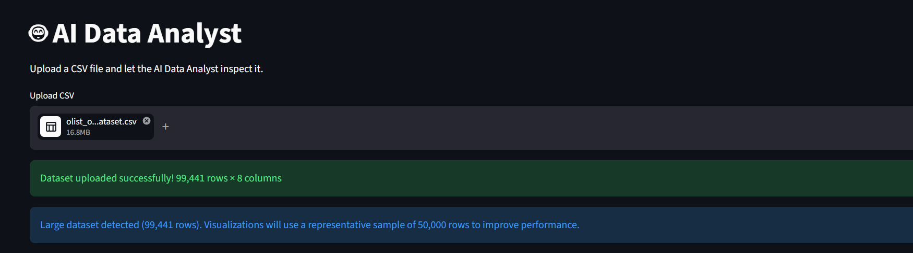
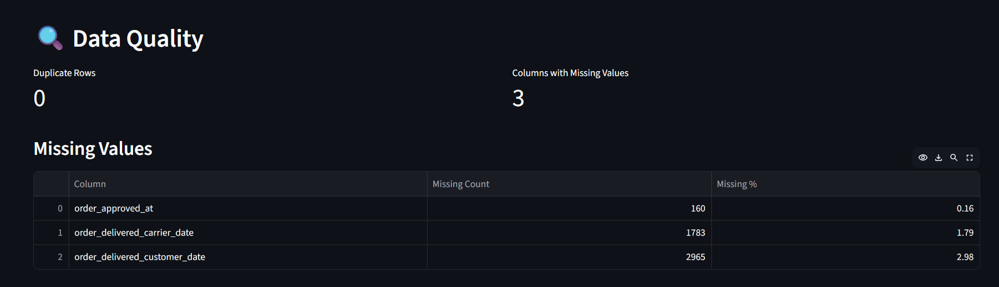
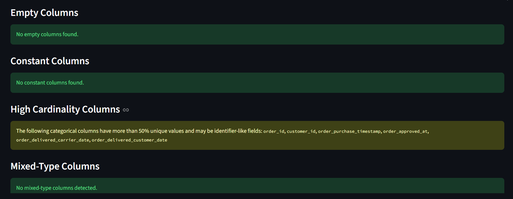
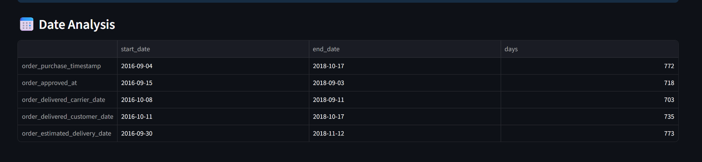
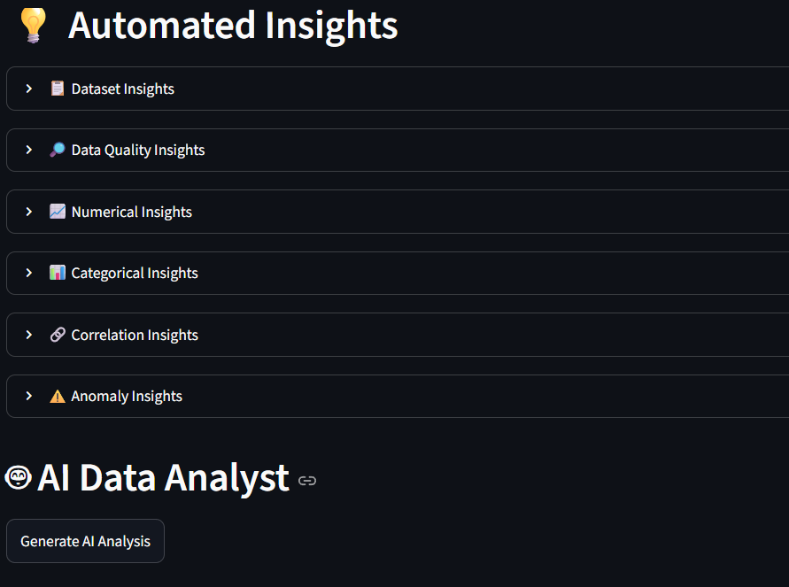
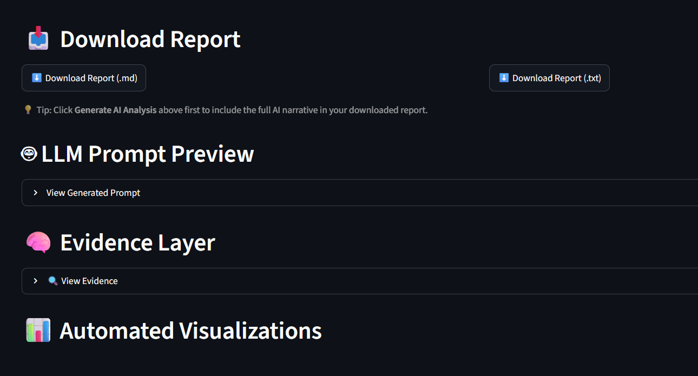
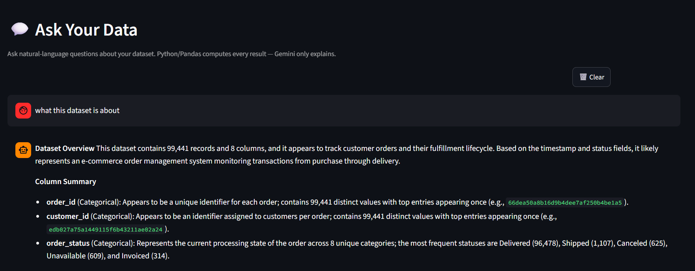

<h1 align="center">🤖 Automated EDA Agent</h1>

<p align="center">
  <b>An AI-powered Exploratory Data Analysis platform with natural-language data querying</b>
</p>

<p align="center">
  
  
  
  
  
  
  
  
</p>

---

## 📌 Overview

**Automated EDA Agent** eliminates the repetitive overhead of exploratory data analysis. Upload any CSV dataset and the application automatically runs a full analytical pipeline — data profiling, quality checks, statistical EDA, anomaly detection, AI-generated narrative reports, and an interactive natural-language question interface — all without writing a single line of code.

The application is built on a strict **evidence-first principle**: every Gemini-generated statement is grounded in Python/Pandas-computed results. The AI model explains; it never fabricates or recalculates.

---

## 🎯 Problem Statement

Organisations routinely receive new datasets they need to understand quickly. Setting up custom EDA scripts for each dataset wastes time and expertise. Automated EDA Agent eliminates that overhead:

- Upload a CSV → receive a structured, evidence-grounded analytical report
- Ask follow-up questions in plain English
- Download the full report as Markdown or plain text
- No code, no setup, no domain-specific scripting

---

## ✨ Key Features

| Feature | Description |
|---|---|
| **Automated EDA** | Descriptive statistics, distributions, correlations and skewness for every column |
| **Data Quality Analysis** | Missing values, duplicates, constant columns, empty columns, mixed-type detection, high-cardinality flagging |
| **Data Cleaning** | Whitespace normalisation, categorical standardisation, smart title-casing with ID/email/URL detection |
| **Interactive Visualisations** | Histograms with marginal box, categorical bar charts, correlation heatmap, time-series plots — all with large-dataset sampling |
| **IQR Anomaly Detection** | Per-column outlier detection using the interquartile range method |
| **Isolation Forest** | Multivariate anomaly detection using scikit-learn's Isolation Forest |
| **Supervised Model Validation** | Accuracy, precision, recall and F1 metrics computed from prediction columns already in the dataset |
| **Gemini AI Reports** | Evidence-grounded narrative analysis and insights using Google Gemini Flash |
| **Ask Your Data** | Conversational interface — ask natural-language questions, get Pandas-computed answers with charts |
| **Dataset Overview** | Ask "What is this dataset about?" — receive a full AI-narrated description grounded in computed statistics |
| **Downloadable Reports** | Export the complete analysis as Markdown or plain text |

---

## 🛠️ Technology Stack

| Layer | Technology | Version |
|---|---|---|
| **Frontend** | [Streamlit](https://streamlit.io/) | 1.61+ |
| **Data Processing** | [Pandas](https://pandas.pydata.org/) + [NumPy](https://numpy.org/) | 2.3+ / 2.2+ |
| **Visualisation** | [Plotly](https://plotly.com/python/) | 7.1+ |
| **Machine Learning** | [scikit-learn](https://scikit-learn.org/) | 1.7+ |
| **AI / LLM** | [Google Gemini Flash](https://ai.google.dev/gemini-api/docs/models) via `google-genai` | 2.17+ |
| **Configuration** | [python-dotenv](https://pypi.org/project/python-dotenv/) | 1.2+ |
| **Resilience** | [Tenacity](https://tenacity.readthedocs.io/) (exponential back-off retry) | 9.1+ |
| **Testing** | [pytest](https://pytest.org/) | 9.2+ |
| **Language** | Python | 3.10+ |

---

## 🏗️ Architecture & Workflow

```
                         ┌─────────────────────────────┐
                         │        CSV File Upload        │
                         └────────────┬────────────────┘
                                      │
                         ┌────────────▼────────────────┐
                         │   app.py  — Streamlit UI     │
                         │   Orchestration & State      │
                         └──────────────┬──────────────┘
                                        │
              ┌─────────────────────────┼──────────────────────────┐
              │                         │                            │
   ┌──────────▼──────────┐  ┌──────────▼──────────┐  ┌────────────▼───────────┐
   │  Analysis Pipeline   │  │  AI Report Pipeline  │  │  Ask Your Data Pipeline │
   ├──────────────────────┤  ├──────────────────────┤  ├────────────────────────┤
   │ profiler.py          │  │ llm_agent.py         │  │ query_interpreter.py   │
   │ data_quality.py      │  │ insight_engine.py    │  │ query_engine.py        │
   │ data_cleaning.py     │  │ evidence_engine.py   │  │ ask_your_data.py       │
   │ eda.py               │  │ report_builder.py    │  │                        │
   │ context_engine.py    │  │                      │  │ NL Question            │
   │ anomaly.py           │  │ Gemini API           │  │   → JSON Query Plan    │
   │ supervised_          │  │ (explains results,   │  │   → Pandas Execution   │
   │   validation.py      │  │  never fabricates)   │  │   → Gemini Narrative   │
   │ visualization.py     │  │                      │  │   → Answer + Chart     │
   └──────────────────────┘  └──────────────────────┘  └────────────────────────┘
```

**Security model:**
- Raw dataset rows are **never** sent to Gemini — only compact schema summaries and computed result snippets
- All calculations are performed by Python/Pandas; Gemini explains, never recalculates
- `eval()` and `exec()` are **never** used anywhere in the codebase
- All Ask Your Data query operations are validated against a strict allowlist of 16 safe operations

---

## 📁 Project Structure

```
automated-eda-agent/
├── app.py                            # Main Streamlit application (~1,500 lines)
├── requirements.txt                  # Python dependencies
├── .env.example                      # Environment variable template
├── .gitignore
│
├── prompts/
│   ├── analyst_prompt.txt            # Gemini EDA report system prompt
│   └── query_interpreter_prompt.txt  # Gemini query plan system prompt (16 operations)
│
├── src/
│   ├── profiler.py                   # Dataset profiling (types, stats, datetime detection)
│   ├── data_quality.py               # Quality checks (missing, duplicates, constants, mixed types)
│   ├── data_cleaning.py              # Categorical standardisation and normalisation
│   ├── eda.py                        # Descriptive statistics, correlations, distribution metrics
│   ├── context_engine.py             # Dataset context inference (target column detection)
│   ├── anomaly.py                    # IQR + Isolation Forest anomaly detection
│   ├── supervised_validation.py      # Classification metrics from prediction columns
│   ├── insight_engine.py             # Rule-based insight generation
│   ├── evidence_engine.py            # Evidence assembly and LLM evidence packaging
│   ├── llm_agent.py                  # Gemini client, retry logic, prompt builder
│   ├── report_builder.py             # Markdown report assembly (7 sections)
│   ├── visualization.py              # Plotly chart functions with sampling support
│   ├── query_engine.py               # Safe validated query execution (16 operations)
│   ├── query_interpreter.py          # Gemini NL → structured JSON query plan
│   └── ask_your_data.py              # Full Ask Your Data pipeline orchestration
│
└── tests/                            # 303 tests — all passing
    ├── test_anomaly.py
    ├── test_ask_your_data.py
    ├── test_data_quality.py
    ├── test_llm_agent.py
    ├── test_query_engine.py
    ├── test_report_builder.py
    ├── test_visualization.py
    └── ...
```

---

## 🚀 Installation

### Prerequisites

- Python 3.10 or later
- A [Google Gemini API key](https://aistudio.google.com/app/apikey) (free tier available)

### 1. Clone the repository

```bash
git clone https://github.com/KetanSaini7/automated-eda-agent.git
cd automated-eda-agent
```

### 2. Create a virtual environment

```bash
# Windows
python -m venv .venv
.venv\Scripts\activate

# macOS / Linux
python -m venv .venv
source .venv/bin/activate
```

### 3. Install dependencies

```bash
pip install -r requirements.txt
```

### 4. Configure your API key

```bash
# Windows
copy .env.example .env

# macOS / Linux
cp .env.example .env
```

Open `.env` and replace the placeholder with your real Gemini API key:

```env
GOOGLE_API_KEY=your-google-gemini-api-key-here
HF_TOKEN=your-huggingface-token-here   # optional
```

> ⚠️ **Never commit `.env` to version control.** It is listed in `.gitignore`.

---

## ▶️ Running the Application

```bash
streamlit run app.py
```

The app opens at `http://localhost:8501` in your default browser.

---

## 💡 Usage

### Standard EDA Workflow

1. Click **Browse files** and upload any CSV dataset.
2. The application automatically runs:
   - Dataset profiling and context detection
   - Data quality analysis
   - Exploratory data analysis (statistics, correlations)
   - Anomaly detection (IQR + Isolation Forest)
   - Insight generation
   - Gemini AI narrative report
3. Scroll through the sections to review all results.
4. Click **⬇️ Download Report (.md)** or **⬇️ Download Report (.txt)** to save the full report.

### Supervised Model Validation *(optional)*

If your dataset contains a target column and a prediction column:
1. Select the **Target Column** from the dropdown.
2. Select the **Prediction Column** (and optionally a **Probability Column**).
3. Classification metrics (accuracy, precision, recall, F1) are computed automatically.

### Ask Your Data

The **💬 Ask Your Data** section appears after uploading a dataset. Type a natural-language question and press **Enter**.

**How it works:**
1. Only your question + a compact schema summary are sent to Gemini
2. Gemini returns a structured JSON query plan (no raw data leaves your machine)
3. The plan is validated against an operation allowlist
4. Python/Pandas executes the query on your full dataset
5. The computed result is sent to Gemini for plain-language explanation

#### Example questions

**Dataset overview**
- *What is this dataset about?*
- *Describe the columns in this dataset.*
- *Give me an overview of this data.*

**Numerical analysis**
- *What is the average sales value?*
- *What is the maximum profit?*
- *Describe the distribution of transaction amounts.*

**Categorical analysis**
- *Which product category has the highest total revenue?*
- *Show the top 5 regions by sales.*
- *What is the distribution of payment methods?*

**Date-based trends**
- *Show monthly revenue trends.*
- *Which month had the highest sales?*
- *Show weekly order counts.*

**Filtering**
- *What is the average profit for transactions where sales exceed 1,000?*
- *Total sales in the North region.*

**Data quality**
- *How many missing values are there?*
- *Which columns have the most null values?*
- *Summarise the data quality.*

**Anomalies & model**
- *How many anomalies were detected?*
- *What is the model's precision and recall?*

---

## 🧪 Running the Tests

```bash
# Run all tests
python -m pytest tests/ -v --tb=short

# Run only the core suite (no Gemini API key required)
python -m pytest tests/test_data_quality.py tests/test_visualization.py \
    tests/test_report_builder.py tests/test_query_engine.py \
    tests/test_ask_your_data.py -v
```

**Test results:** 303 tests — all passing. The core suite (data quality, visualisation, report builder, query engine, Ask Your Data) requires no API key.

---

## 📊 Large Dataset Handling

| Component | Strategy |
|---|---|
| **Visualisations** | Randomly sampled to 50,000 rows; sample is clearly labelled in chart titles |
| **Anomaly detection** | Capped at 200,000 rows for Isolation Forest |
| **Ask Your Data** | Runs on the full dataset for exact calculations |
| **Gemini context** | Only compact schema (column names, types, 5 sample values per column) is sent |
| **Result display** | Tables capped at 50 rows; excess is noted |

---

## 🔒 Security and Privacy

| Concern | Approach |
|---|---|
| **API key** | Read from environment variable (`GOOGLE_API_KEY`), never hardcoded. `.env` is git-ignored. |
| **Uploaded data** | Processed entirely in-memory. No data is written to disk or sent to external services. |
| **Gemini context** | Raw dataset rows are **never** transmitted to Gemini. Only: column names, dtypes, missing %, up to 5 sample values, and computed result summaries (≤ 30 rows). |
| **Code execution** | `eval()` and `exec()` are not used. All query operations are validated against a fixed allowlist. |
| **Sensitive columns** | High-cardinality columns (IDs, emails, URLs) are detected and excluded from title-casing and certain analyses. |

---

## ⚠️ Known Limitations

- **Single-condition filters:** Ask Your Data supports one filter condition per query (e.g. `region == "North"`). Compound AND/OR filters are not yet supported.
- **Chart types:** Automatic chart generation is available for group-by aggregations, time-series, and value counts. Statistics and correlations are shown as tables only.
- **Date parsing:** Columns not automatically detected as datetime can still be queried if ≥80% of values parse as dates. Ambiguous formats fall back to `dateutil`.
- **Gemini availability:** Under high API load, requests may receive 503 errors; the application retries automatically up to 3 times with exponential back-off.
- **Conversation memory:** Each Ask Your Data question is answered independently. Gemini receives the last 6 conversation turns as context, but the query engine has no cross-question memory of previous results.

---

## 🔭 Future Improvements

- Multi-condition filtering (AND/OR) in Ask Your Data
- Support for Excel (`.xlsx`) and Parquet file uploads
- Interactive column-type override (allow users to reclassify columns)
- Persistent conversation history export
- Streamlit Cloud / Docker deployment configuration
- Scheduled automated reports for recurring datasets

---

## 📸 Screenshots

### Upload & Dataset Detection


### Data Quality Analysis


### Quality Checks — Empty, Constant & High Cardinality Columns


### Date Analysis


### Automated Insights


### Additional Views




---

## 📄 Licence

This project is licensed under the **MIT License** — see the [LICENSE](LICENSE) file for details.

---

<p align="center">
  Built with ❤️ using Python, Streamlit, Pandas and Google Gemini
</p>
